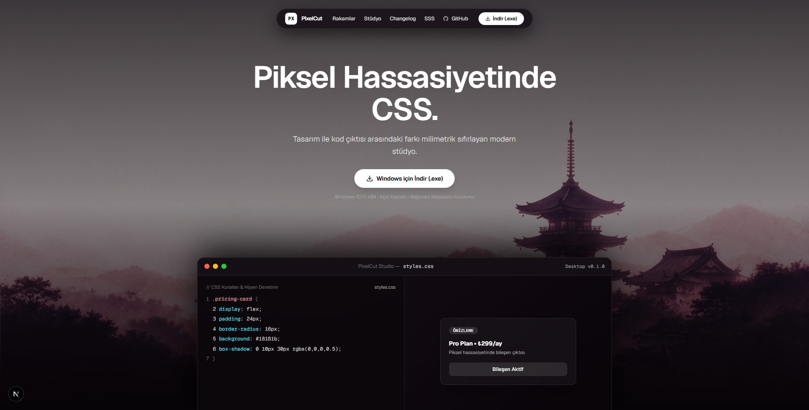
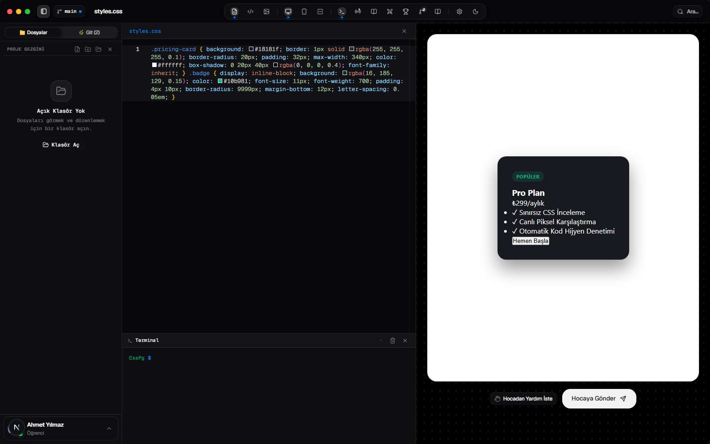

# PixelCut

A desktop CSS studio for frontend classrooms. Students recreate a design in HTML and CSS, the editor tells them how clean their CSS is, and the instructor watches the whole class live and can step into any student's code.



**Website:** [pixelcut.onuracar.dev](https://pixelcut.onuracar.dev) · **Download:** [GitHub Releases](https://github.com/onuracar-dev/PixelCut/releases) (Windows x64 installer)

---

## What it does

**For students**
- **Code + live preview.** A Monaco editor (the editor inside VS Code) for HTML and CSS, next to a live canvas with desktop and phone views.
- **Diff slider.** Drag a curtain across your output and the target design to see where they differ.
- **CSS hygiene check.** Flags CSS classes that the HTML never uses and stylesheets that run longer than the component needs.
- **Time-Travel replay.** Every 2.5 seconds, if your code has changed, a snapshot is saved (the last 120 are kept). You can scrub back to see when something broke.
- **Practice arena.** Challenges at four difficulty levels, with XP and a leaderboard.

**For instructors**
- **Class radar.** Every student's code streams to the instructor's screen in real time.
- **Live help.** Students can raise a help request, and the instructor can open their workspace and fix code with them.
- **Challenge builder.** Create new challenges for the class.

**Desktop app**
- Open, edit and save real project folders on your computer.
- A built-in terminal panel.
- Auto-updates from GitHub Releases.
- A Git panel with diff previews. The commit history it shows is sample data; pushing goes to GitHub through the REST API.



---

## How it fits together

```
┌──────────────────────────┐        ┌───────────────────────────┐
│  Electron shell          │        │  Supabase                 │
│  electron/main.js        │        │  · Realtime channels      │
│  · window controls       │        │    (live code, presence,  │
│  · file system + terminal│        │     help requests)        │
│  · auto-updater          │        │  · challenges, submissions│
└───────────┬──────────────┘        └─────────────▲─────────────┘
            │ IPC (preload.js)                    │
┌───────────▼─────────────────────────────────────┴─────────────┐
│  Next.js app (static export)                                  │
│  /      → landing page (also deployed to Cloudflare)          │
│  /app   → the studio: editor, preview, classroom, arena       │
└───────────────────────────────────────────────────────────────┘
```

The same Next.js build powers both the website and the desktop app. `next build` writes a static site to `out/`. Electron loads it as the app's UI, and Cloudflare serves it as the website.

Live classroom traffic uses Supabase Realtime **broadcast** messages, so keystrokes go straight to the instructor without being written to the database. Only finished challenge submissions are saved.

---

## Getting started

**Requirements:** Node.js 20+ and npm.

```bash
npm install
```

**Run the desktop app in development** (starts Next.js and Electron together):

```bash
npm run desktop:dev
```

**Run in the browser only:**

```bash
npm run dev
```

Then open http://localhost:3000/app.

**Build the Windows installer:**

```bash
npm run desktop:build
```

The installer is written to `dist-electron/`.

### Supabase (optional)

The classroom and arena features need a Supabase project. Create a `.env.local` file:

```env
NEXT_PUBLIC_SUPABASE_URL=https://your-project.supabase.co
NEXT_PUBLIC_SUPABASE_ANON_KEY=your-anon-key
```

Without these, the app still runs and uses local sample data. The database schema is not in this repo yet. The app reads and writes the `challenges` and `submissions` tables.

---

## Project structure

```
electron/            Electron main process and preload bridge
src/app/page.tsx     Landing page
src/app/app/         The studio
src/components/
  workspace/         Editor, diff slider, time-travel replay
  classroom/         Class radar, help requests, challenge builder
  mac-ide/           Window chrome, file tree, terminal, dock
  git/               Git panel and GitHub sign-in
  leaderboard/       Arena leaderboard
src/lib/             Supabase client, realtime, CSS analyzer, GitHub API
wrangler.jsonc       Cloudflare deploy config for the website
```

---

## Tech stack

| Part | Tools |
| --- | --- |
| Desktop shell | Electron, electron-builder, electron-updater |
| UI | Next.js 16, React 19, TypeScript |
| Styling | Tailwind CSS 4, Motion |
| Editor | Monaco Editor |
| Backend | Supabase (Postgres, Realtime) |
| Website hosting | Cloudflare Workers (static assets) |

---

## Deployment

**Website:** Cloudflare runs `npx wrangler deploy`. `wrangler.jsonc` runs `npm run build` first, then uploads `out/`.

**Desktop app:** Pushing a `v*` tag runs `.github/workflows/release.yml`. It builds the Windows installer and publishes it to GitHub Releases, and installed apps pick up the update automatically.

---

## License

[MIT](./LICENSE)
